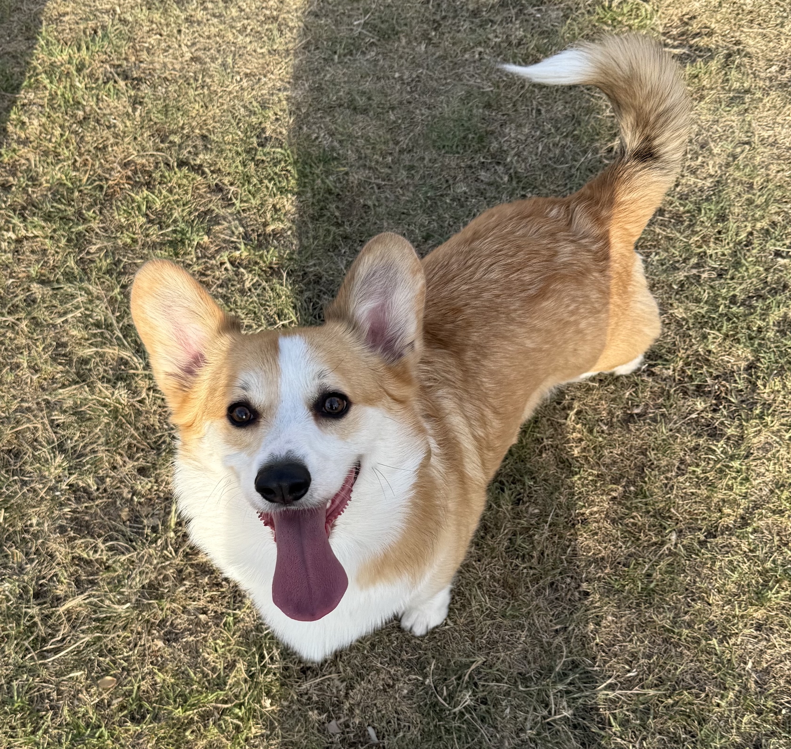

# 🎮 SNACK DEFENDER: DOBBY'S RUSH 🐶🦝🐥🐿️
yana’s first solo project 
for my precious little corgi who takes his snacks very seriously ♡ 
 
 
 
DRAFT 
*will update this properly once the game is actually done *
 
 
<b>inspiration</b> 
dobby obviously. bc he’s my baby and i love him more than anything on earth. 
 
i originally came up with this idea for my fundamentals of interaction design assignment about a year ago? it was a conceptual arcade machine with bone shaped hammers, motion sensitive gloves and animals popping out of bushes. my tutor said the game design was really interesting. i randomly remembered the assignment while planning this project and thought why don’t i actually make this??? 
 
so this is my attempt at turning that arcade concept into a little browser game people can play on their pcs or phones. 
 
 
<b>idea</b> 
a tiny cute project as a little warmup to get back into coding before jumping into bigger projects over summer break. 
something small enough to finish quickly & fun that i actually feel happy working on. 
can personalize ofc featuring dobby bc why not??? 
give me some programming logic to practice. 
 
*est. time: around 5 days for the first version depending on how much time i spend debugging & making dobby look cute (very important) lol *
 
 
<b>concept / plot</b> 
dobby has collected his favorite snacks and is having a perfectly nice day until some sneaky raccoons decide they want a share. 
um.. excuse me????? absolutely unacceptable. 
help dobby protect his snacks by bopping the raccoons when they pop out of the bushes. sometimes a squirrel or duck appears too. so pay attention cuz those are friends. 
score as many points as possible before the round ends. 
 
 
<b>physical arcade machine to online game</b> 
\- hammers -> clicking or tapping animals 
\- popup holes -> illustrated bushes 
\- pressure sensors -> code checking which animal the player clicked 
\- LED indicators -> icons and visual effects 
\- paw shaped start button -> clickable/tappable paw button bc that stays 
\- dobby’s reactions -> switching between images based on what happens 
~~\- motion gloves -> idk this just wouldn’t transfer directly.. maybe measure response time and fast acurate consecutive hits could earn a combo bonus ~~
 
 
**first version** 
*will focus on the basic tapping game. simple and manageable with room for other stuff later *
 
1\. start screen 
\- game title, dobby saying “protect my snacks” 
\- paw shaped start button 
\- short instructions showing the raccoon and forest animal friends 
 
2. playing screen 
\- six bushes 
\- one animal appears at a time in a random bush 
\- animals stay visible briefly then disappear 
\- raccoons appear more often than animal friends 
\- one fixed speed to start with 
 
3. basic game logic 
\- 30 second round 
\- raccoon hit: +10 points and happy dobby 
\- duck/squirrel hit: -5 points but score stays at zero or above 
\- missed raccoon: no points 
\- duck/squirrel left alone: no points or penalty. good job minding ur business dobs lol 
\- tapping an empty bush: nothing happens 
\- each animal can only be scored once 
these are starting values. i’ll adjust them if the game feels too easy, too fast or annoying. 
 
4. dobby’s reactions 
\- normal / watching 
\- happy after a raccoon hit 
\- sad after hitting a friend 
\- short messages like “woof woof!” and “oops that was a friend” 
 
5. end screen 
\- final score 
\- a message from dobby 
\- play again button 
 
6. restart 
\- reset the score, timer, animals and dobby’s expression properly 
\- starting a new game should actually start a new game 
 
 
**extras for later** 
\- easy / normal / hard modes 
\- combo counter and bonus points 
\- multiple animals appearing at once 
\- saved personal best 
\- more expressions and character animations 
\- sound effects, background music and sound controls 
\- extra locations (beach, park, etc.) or different snack collections 
sounds can wait until the basic game works 
 
 
**skills / tech stack** 
html, css, javascript only. no overcomplication. bc it’s meant to be fun not give me headaches. 
 
html 
\- organizing the start, game, end screens 
\- buttons, images, score and timer text 
\- using proper buttons so keyboard interaction works too 
 
css 
\- grid layout for the bushes 
\- positioning animals inside each bush 
\- showing and hiding different states 
\- making the layout fit both desktop and phone screens 
\- simple visual feedback when something gets hit 

javascript 
\- arrays and objects for the animal types 
\- functions for starting, spawning, scoring & ending a round 
\- random numbers to choose animals and bushes 
\- conditions to decide whether a target is a raccoon or friend 
\- click events 
\- timers and cancelling timers 
\- updating text, images and classes on the page 
\- keeping track of game state 
 
 
**programming logic** 
the basic round: start game → reset everything → show an animal → player hits it or it disappears → show the next animal → stop when time runs out. 
 
things the game needs to remember 
\- on the start screen, playing or finished? 
\- current score 
\- when the round should end 
\- which bush is active 
\- which animal is there 
\- the animal’s already been hit? 
\- which timers are currently running 
 
when someone taps a bush 
1\) check the game is still running 
2\) check there’s an active animal there 
3\) check it hasn’t already been hit 
4\) mark it as handled immediately 
5\) update the score and dobby’s reaction 
6\) remove the animal and continue the round 
i’ll keep this information in javascript and update the screen from it 
 
 
**tricky parts** 
keeping the game’s state correct!!! (what if someone clicks too quickly or restarts midway..?) 
movement and timing.. ughhh will probs need to actually play it and adjust 
double tapping (one raccoon giving unlimited points) 
artwork & phone layout (bushes need to be big enough to tap & spaced out enough to avoid accidental hits) 
handling timers (overlapping after a restart, countdown accuracy. how to calculate remaining time from an actual end time?) 
and more..... 
 
 
**ui design** 
\- bright colorful cute little garden arcade 
\- sky blue background, green bushes and grass 
\- dobby and his snack beside the playing area 
\- score and timer clearly visible at the top 
\- 6 bushes arranged in a grid 
leaning towards simple cartoon illustrations to match my original concept. raccoons and friends should look clearly different!! should be easy for players to understand the game. might just use simple static images for the first version cuz the personality can come from dobby’s expressions and messages anyway. 
 
 
**realistic 5 day plan** 
day 1 setup + basic layout 
\- create project folder and files 
\- sketch where the screens, bushes, dobby will go 
\- build the score, timer, 6 bush layout 
\- make one test animal appear & clicking it change the score once 
*goal: can click one animal and see the correct response *
 
day 2 make the main game loop work 
\- choose a random bush and animal 
\- make animals appear and disappear repeatedly 
\- handle raccoon hits and animal friend mistakes 
\- stop repeated clicks from scoring twice 
\- add basic dobby messages 
\- check that each appearance only finishes once 
*goal: animals keep appearing and the scoring rules work *
 
day 3 complete the game logic & prototype 
\- add the 30 second round, start and end screens 
\- stop everything when the round ends 
\- show the final score 
\- implement restart (reset timer and everything!!!) 
\- test rapid clicking, missed animals, restarting midway 
*goal: can start, finish and replay a complete round *
 
day 4 polish ui + decor + make it feel like dobby’s game 
\- add character images and expressions 
\- style the garden, buttons, bushes, etcetc 
\- check keyboard focus and instructions 
\- play a few rounds and adjust the speed & layout for phones & add feedback for hits 
*goal: the game looks clear and cute & feels comfortable to play *
 
day 5 test + finish 
\- test on my pc & phone 
\- make someone play without me explaining & take a moment to appreciate how cute dobby is, ask for feedback 
\- fix confusing behavior or bugs if theres any 
\- write a proper readme with screenshots, what actually works, reflection, future improvements, etcetc. 
\- put the finished first version on github yayyy 
*goal: someone else can play the game without getting stuck *
 
 
 
\*** if i run out of time *** 
 
keep the artwork simple and use fewer expressions, cut whatever isn’t necessary 
the main goal is a complete playable game 
 
future dobby can have the fancy animations ♡ 
